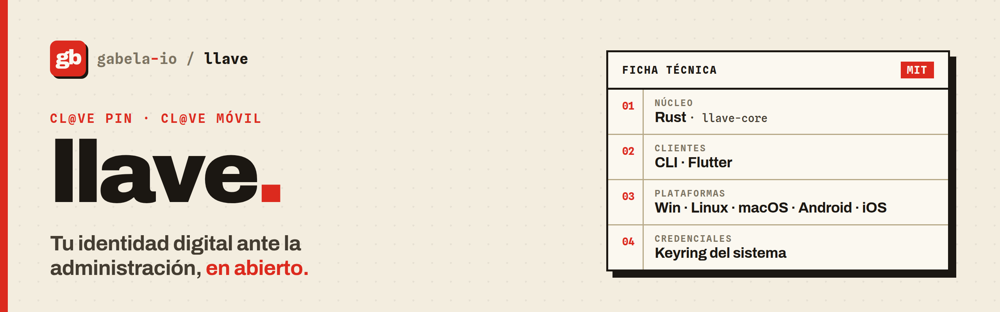

<div align="center">

<picture>
  <source media="(prefers-color-scheme: dark)" srcset=".github/assets/banner-dark.png">
  
</picture>

### An open-source Cl@ve client for the terminal, the desktop and Android.

**Activate your device, reveal your Cl@ve PIN and approve logins, without the official app.**

[](https://github.com/gabela-io/llave/actions/workflows/ci.yml)
[](book/src/introduction.md)
[](crates/)
[](flutter/)
[](flake.nix)
[](LICENSE)

[Quick start](#quick-start) · [Usage](#usage) · [Documentation](#documentation) · [Development](#development)

<code>nix run github:gabela-io/llave#llave-cli</code>

</div>

An open-source client for **Cl@ve**, Spain's digital identity system for public administration services. Activate a device, reveal your Cl@ve PIN and approve Cl@ve Móvil logins from the terminal or a desktop/Android app, with a single Rust core behind both.

## About

The official Cl@ve PIN app only runs on a phone. **llave** brings the same functionality to the command line and to a Flutter app for Linux and Android, so you can sign in to AEAT, Seguridad Social or any other Cl@ve-enabled service from your computer.

It speaks the same protocol as the official app (v6.2.10): the same endpoints, activation flow and security checks. Its code is open and auditable.

> [!IMPORTANT]
> llave is an **unofficial** project and is not affiliated with or endorsed by the Agencia Tributaria or any other public body.
> It acts with **your real identity**. Credentials are stored only on your machine (encrypted with your PIN), nothing is sent anywhere except to the official AEAT servers, and there is no telemetry.

### Compatibility

llave has its own version number. Each release matches one version of the official app; `llave --version` and the app's settings show both.

| llave | Official Cl@ve app |
|-------|--------------------|
| 0.1.0 | 6.2.10 (build 294) |

See the [changelog](CHANGELOG.md) for what each release changes.

## Features

- **Device activation** with your DNI/NIE and an SMS code, like the official app
- **Cl@ve PIN**: reveal the PIN you requested on the AEAT website
- **Cl@ve Móvil**: poll, confirm and reject login requests, with the app's security check
- **QR login**: confirm a login shown as a QR code (text or `appclave/qrscan` link)
- **Account data and history** of your authentications
- **Scriptable output**: JSON by default, `--plain` for humans
- **Flutter app** for Linux desktop and Android, powered by the same Rust core

## Quick start

```bash
# 1. Install
nix run github:gabela-io/llave#llave-cli -- --help

# 2. Activate this device (asks for the SMS code sent to your phone)
llave activate --nif 12345678Z --fecha 01-01-2030

# 3. Start a PIN request on the AEAT website, then reveal it
llave pin
```

## Installation

### With Nix (recommended)

```bash
nix run github:gabela-io/llave#llave-cli
```

### Prebuilt binaries

Each [release](https://github.com/gabela-io/llave/releases) has a static Linux CLI (`llave-<version>-linux-x86_64`), the Android app (`llave-<version>.apk`) and `SHA256SUMS`. Check the download before running it:

```bash
sha256sum --check --ignore-missing SHA256SUMS
chmod +x llave-0.1.0-linux-x86_64
```

### From source

```bash
cargo install --path crates/llave-cli
```

### Requirements

- Nix, or a stable Rust toolchain
- Linux (or macOS) for the CLI
- Flutter (provided by the dev shell) to build the app

## Usage

| Command | What it does |
|---|---|
| `llave activate` | Register this device (DNI/NIE + SMS code) |
| `llave pin` | Reveal the pending Cl@ve PIN |
| `llave pending` | Check once for pending Cl@ve Móvil requests |
| `llave listen` | Poll until a request arrives |
| `llave confirm` / `llave reject` | Approve or reject a pending request |
| `llave qr` | Confirm a login shown as a QR code |
| `llave history` | List past authentications |
| `llave my-data` | Show your account data (email, phone, level) |
| `llave check` | Check a NIF/NIE against Cl@ve |
| `llave dni-auth` | Run only the DNI/NIE identification step |
| `llave status` | Show the saved session |
| `llave deactivate` | Unregister this device on the server |
| `llave logout` | Forget the local credentials |

Run `llave <command> --help` for all options.

### Activate your device

Identify yourself with your DNI/NIE; the CLI then asks for the code sent by SMS to the phone registered in Cl@ve.

```bash
llave activate --nif 12345678Z --fecha 01-01-2030
```

Which option you need depends on your document:

| Document | Option |
|---|---|
| DNI | `--fecha` with the card's validity date |
| DNI starting with K or L, NIE starting with M | `--fecha` with your date of birth |
| NIE starting with X, Y or Z | `--soporte` with the card's support number |

If the server asks for your date of birth, the CLI prompts for it and retries.

### Reveal your Cl@ve PIN

Request the PIN on the AEAT website first, then:

```bash
llave pin
```

### Approve Cl@ve Móvil logins

The CLI cannot receive push notifications, so it polls the server:

```bash
llave listen                       # every 5 s, up to 60 attempts
llave listen --max-attempts 0      # until a request arrives
llave confirm --token <TOKEN> --idp-code <IDP_CODE>
```

Before confirming, the CLI shows the verification code to compare with the one on the website and asks whether you started the login yourself. Answering no rejects the request; `--yes` skips the prompt.

### Log in with a QR code

Pass the QR text or the `https://sede.agenciatributaria.gob.es/appclave/qrscan?qrcode=…` link. The CLI validates it and confirms the login after the same security check:

```bash
llave qr --value "<qr-code-content>"
```

### History

Defaults match the official app (last 7 days, confirmed requests):

```bash
llave history --days 30 --result all   # all | confirmed | rejected
```

### Output

Commands print JSON by default, or plain text with `--plain`:

```console
$ llave pin --plain
pin: 123456
time_to_live_seconds: 180
nif: 12345678Z
```

Use `-v` for debug logging and `--proxy socks5://…` (or `LLAVE_PROXY`) to go through a proxy.

## Configuration

- **Config**: `$XDG_CONFIG_HOME/llave-cli/config.json`
- **Session**: `$XDG_DATA_HOME/llave-cli/session.sealed`, encrypted with a PIN you choose at activation (Argon2id + AES-256-GCM, file mode 0600). The unlocked session is cached in the kernel keyring for the current login, so the PIN is only asked again after a reboot.

## Documentation

The protocol used by the official app v6.2.10 (endpoints, flows, error codes, cookies and credential storage) is documented as an [mdbook](https://rust-lang.github.io/mdBook/) under `book/`:

```bash
nix run nixpkgs#mdbook -- serve book/
```

- [Architecture](book/src/architecture/system-overview.md): system overview, AEAT infrastructure, app structure
- [API reference](book/src/api-reference/endpoints.md): endpoints, request/response formats, error codes, constants
- [Authentication flows](book/src/authentication-flows/pin-request.md): PIN, Cl@ve Móvil, QR, DNI/NIE + SMS activation
- [Implementation guide](book/src/implementation-guide/cookie-management.md): cookies, client identity, redirects, session persistence
- [Cryptography](book/src/cryptography/device-password.md): device password, credential storage

## Development

```
crates/
├── llave-core/       # API client, auth flows, config, crypto, session
├── llave-core-ffi/   # C ABI + flutter_rust_bridge layer for Flutter
└── llave-cli/        # `llave` binary
flutter/              # Flutter app (Linux, Android)
book/                 # Protocol documentation (mdbook)
```

The dev shell provides the Rust toolchain, Flutter, the Android SDK/NDK and `just`. With [direnv](https://direnv.net/) it loads automatically (`direnv allow`); otherwise run `nix develop`.

```bash
just test              # Rust tests
just lint              # clippy -D warnings
just fmt               # rustfmt
just run pin           # run the CLI
just flutter-run       # Flutter app on Linux
just frb-generate      # regenerate flutter_rust_bridge bindings
just flutter-build-apk # Android APK (after `just build-ffi-android`)
```

Run `just` to list all recipes. Contributions are welcome: please open an issue or pull request.

## License

llave is licensed under the MIT license. See [`LICENSE`](LICENSE).

## Part of gabela

**llave** is part of [gabela](https://github.com/gabela-io): the tools digital government should offer, but doesn't.

- [**puntoBOE**](https://github.com/gabela-io/puntoBOE): BOE tax filing validator that runs entirely in the browser.
- [**boeidl**](https://github.com/gabela-io/boeidl): DSL compiler for the AEAT's record layouts.
- [**website**](https://github.com/gabela-io/website): unofficial documentation on the AEAT.
