# Error Codes

The server puts numeric string codes in the `codigo_error` field of the [response envelope](./request-response-formats.md#standard-response-envelope), with `status: "KO"`. These are not HTTP status codes: JSON responses always come with HTTP 200.

## How the App Shows Errors

- `visible: "S"`: the app shows the server's `mensaje` as is. For `500600` the dialog button is "Update" (opens Google Play).
- Otherwise the app maps `codigo_error` to its own text (`BaseActivity.manageServerKo`, `ClaveDeviceActiveFragment`). Unknown codes get a generic error dialog that shows the code.

## Known Error Codes

"App" is how Cl@ve 6.2.10 reacts; "llave" is what `llave-core` does. Meanings come from the app's own messages unless marked otherwise.

### Device and session

| Code | Endpoint(s) | Meaning | App | llave |
|------|-------------|---------|-----|-------|
| `105` | `ClaveStartingSv`, `ClaveRequestAllOperationsSv`, history, my data, deactivate | Device no longer active in Cl@ve | "Device not active" dialog; **wipes local credentials** | `DeviceNotActive`, deletes the session |
| `109` | Same as `105` | Device revoked; server `mensaje` is shown | Same as `105` (wipes) | Same as `105` |
| `416` | `ClaveRequestAllOperationsSv` | Device not active | Same dialog, **no wipe** | `DeviceNotActive`, keeps the session |
| `666` | Any | Session expired after inactivity | "Su sesión ha expirado tras un tiempo de inactividad" | Generic `Api` error |
| `500600` | Any | App version too old | Update dialog | `AppVersionOutdated` |
| `987` | `ClaveRequestStateSv` | Not documented; probably a missing or invalid `appmovil` cookie (inferred) | Calls `SetCookieAppMovil`, retries once | Same |

### Requests, PIN and QR

| Code | Endpoint(s) | Meaning | App | llave |
|------|-------------|---------|-----|-------|
| `40` | `ClaveRequestAllOperationsSv` | No pending request | Shows the "no request" screen | Treated as "nothing pending" while polling |
| `205` | `ClaveRequestAllOperationsSv`, `ClaveAuthenticateSv`, `ClaveCancelAuthenticateSv` | "Los datos enviados para la operación solicitada no son correctos" | Error dialog | Also treated as "nothing pending" while polling (seen in practice, not in the app). On confirm/reject it has been seen after calling `ClaveStartingSv` first |
| `301` | Request screens | "Ha ocurrido un problema. Pulse en consultar para obtener la última petición pendiente" | Error dialog, poll again | `Api` error |
| `303` | Request screens | Request expired (more than 5 minutes) | Error dialog | `Api` error |
| `305` | Request screens | Request not valid | Error dialog | `Api` error |
| `307` | `ClaveRequestPinSv` | "No tiene disponible ningún PIN válido" | Error dialog | `NoPendingPin` |
| `407` | Any | "Por seguridad, espere unos segundos y reintente" | Error dialog | Listener keeps polling |
| `500` | `ClaveMovilQrSv` | QR code not valid | Warning dialog | `Api` error |
| `501` | `ClaveMovilQrSv` | Cannot create a new request: reject the pending one first | Warning dialog | `Api` error |
| `502` | `ClaveMovilQrSv` | Authentication request expired | Warning dialog | `Api` error |
| `503` | `ClaveMovilQrSv` | Cannot create a new request, try again | Warning dialog | `Api` error |

### Identification and device security

| Code | Endpoint(s) | Meaning | App | llave |
|------|-------------|---------|-----|-------|
| `-8` | `AutenticaDniNieContrasteh` | Date of birth needed | Asks for the date of birth, resends with `AZUL="X"` | `DniBirthDateRequired` (`DniChallenge::Azul`) |
| `-10` | `AutenticaDniNieContrasteh` | Date of birth needed (NIE) | Asks for the date of birth, resends with `FECHANIE="X"` | `DniBirthDateRequired` (`DniChallenge::FechaNie`) |
| `202` | Identification | DNI/NIE format not valid | Error dialog | `Api` error |
| `204` | Request screens | Cl@ve Firma certificate password not correct | Error dialog | `Api` error |
| `406` | Request screens | Biometrics not available right now | Warning dialog | `Api` error |
| `409` | Request screens | Biometric screen lock required | Warning dialog with "Go to settings" | `Api` error |
| `410` | Any | Screen lock required | Error dialog | `Api` error |
| `414` | Any | Biometric screen lock required | Error dialog | `Api` error |
| `415` | Request screens | Android 9 or later required | Warning dialog | `Api` error |

The app handles `406`/`409`/`410`/`414`/`415` in the same code path as server codes. It is not confirmed whether the server sends them or whether the app's own device checks produce them.

### Not handled by the app (seen by llave)

| Code | Endpoint(s) | Meaning | llave |
|------|-------------|---------|-------|
| `902024` | `ObtenerClaveMovilSMS` | Invalid request format: a form body was sent instead of an empty POST | n/a (llave sends an empty body) |
| `16600` | Any | **llave only, empirical**: IP rate limit after too many failed attempts in a day. Not referenced in the app | `IpRateLimited` |

## Non-JSON Error Responses

The AEAT server has two failure modes that don't return JSON:

### HTML Login Page (HTTP 200)

When session cookies are missing, expired, or invalid, the server returns an HTML login page instead of a JSON error. Detection: check if the response body starts with `<!DOCTYPE` or `<html`.

```rust
let trimmed = body.trim_start();
if trimmed.starts_with("<!DOCTYPE") || trimmed.starts_with("<html") {
    return Err(LlaveError::HtmlResponse { endpoint });
}
```

### WAF Rejection

When the `User-Agent` header is missing or truncated, the server's WAF/reverse proxy rejects the request with an HTML error page containing "Pagina no habilitada en internet publico" (page not enabled on public internet).

See [Client Identity](../implementation-guide/client-identity.md) for the required User-Agent format.

## Error Type Hierarchy

```mermaid
graph TD
    E[LlaveError] --> H[Http - Network failures]
    E --> A[Api - Server returned KO]
    E --> DNA[DeviceNotActive - 105/109/416]
    E --> NP[NoPendingPin - no PIN to reveal / 307]
    E --> AV[AppVersionOutdated - 500600]
    E --> RL[IpRateLimited - 16600]
    E --> BD[DniBirthDateRequired - -8/-10]
    E --> D[DniAuthFailed - Bad DNI credentials]
    E --> NR[NotRegistered / NoRegisteredPhone]
    E --> QR[InvalidQr - QR check failed]
    E --> HR[HtmlResponse - Got HTML instead of JSON]
    E --> TR[TooManyRedirects - more than 20]
    E --> NS[NoSession - No saved credentials]
    E --> J[Json - Parse failure]
    E --> KR[Keyring - session cache failure]
    E --> NIF[InvalidNif - Bad NIF format]
    E --> CR[Crypto - Encryption failure]
    E --> IO[Io - File system error]
    E --> CF[Config - Configuration error]

    HR -->|"&lt;!DOCTYPE..."| A2["Session expired or<br/>cookies missing"]
    D -->|"non-JSON body,<br/>0 redirects"| A3["Wrong NIF, fecha,<br/>or soporte"]
```



`NotRegistered` and `NoRegisteredPhone` mirror the app's gate after `ClaveRequestStateSv`: the SMS is only requested when `registrado == "true"` and `telefono == "S"`.

## DNI Auth Failure Detection

`AutenticaDniNieContrasteh` is sent with `modo=json`, and the app parses the final body as the standard JSON envelope: `status: "KO"` with `-8`/`-10` asks for the date of birth, any other KO is an error. If the body is not JSON, the app treats it as success.

llave parses JSON the same way. For a non-JSON body it keeps an older heuristic: success needs at least one redirect, and a reply with no redirect (the login form again) means wrong credentials:

```rust
if redirect_count == 0 {
    return Err(LlaveError::DniAuthFailed);
}
```

Whether the server answers with JSON or HTML here has not been confirmed with real traffic.
