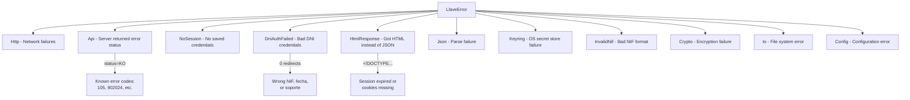

# Error Codes

The server uses numeric string error codes in the `codigo_error` field of the [response envelope](./request-response-formats.md#standard-response-envelope). These are not HTTP status codes -- the HTTP response is always 200 OK for JSON responses.

## Known Error Codes

| Code | Endpoint(s) | Meaning | Action |
|------|-------------|---------|--------|
| `105` | `ClaveStartingSv`, `ClaveRequestAllOperationsSv` | Device/session not established | Expected during new registration. Continue the flow. For AllOperations: device not properly registered. |
| `109` | `ClaveRequestAllOperationsSv` | Device not properly registered | Re-activation required. Device may have been deactivated server-side. |
| `205` | `ClaveRequestAllOperationsSv`, `ClaveAuthenticateSv` | No pending operations / "datos no correctos" | For polling: normal "nothing to see" response. For authenticate: usually caused by calling `ClaveStartingSv` before authenticate (resets session state). |
| `307` | `ClaveRequestPinSv` | "No tiene disponible ningun PIN" | No PIN available. May indicate the device session wasn't properly validated (missing `ClaveRequestAllOperationsSv` call). |
| `902024` | `ObtenerClaveMovilSMS` | Invalid request format | Caused by sending form-encoded data instead of an empty POST body. |
| `16600` | Any endpoint | IP rate-limited by AEAT | The IP address has exceeded the maximum number of failed attempts per day. Try again tomorrow or use a different IP. |

## Non-JSON Error Responses

The AEAT server has two failure modes that don't return JSON:

### HTML Login Page (HTTP 200)

When session cookies are missing, expired, or invalid, the server returns an HTML login page instead of a JSON error. Detection: check if response body starts with `<!DOCTYPE` or `<html`.

```rust
let trimmed = body.trim_start();
if trimmed.starts_with("<!DOCTYPE") || trimmed.starts_with("<html") {
    return Err(LlaveError::HtmlResponse { endpoint });
}
```

### WAF Rejection

When the `User-Agent` header is missing or truncated, the server's WAF/reverse proxy rejects the request with an HTML error page containing "Pagina no habilitada en internet publico" (page not enabled on public internet).

See [Client Identity](../implementation-guide/client-identity.md) for the required User-Agent format.

## Error Type Hierarchy



## DNI Auth Failure Detection

The `AutenticaDniNieContrasteh` endpoint doesn't return a JSON error on failure. Instead, it returns the login form again (HTTP 200, no redirect). The client detects this by counting redirects -- a successful authentication always produces at least one redirect:

```rust
if redirect_count == 0 {
    return Err(LlaveError::DniAuthFailed);
}
```
