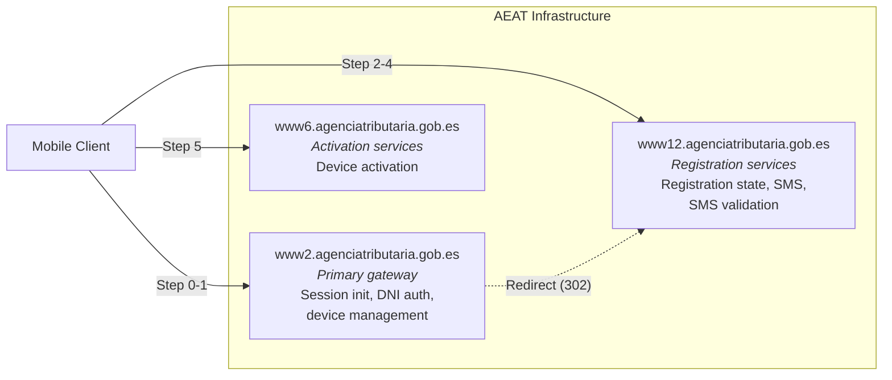

# AEAT Infrastructure

AEAT distributes its mobile API across multiple subdomains, each backed by separate WebSphere Application Server clusters.

## Subdomain Map

## Subdomain Roles

| Subdomain | Base URL | Role |
|-----------|----------|------|
| **www2** | `https://www2.agenciatributaria.gob.es` | Primary entry point. Handles session initialization (`ClaveStartingSv`), DNI/NIE authentication (`AutenticaDniNieContrasteh`), and most device management endpoints. |
| **www12** | `https://www12.agenciatributaria.gob.es` | Registration and SMS services. Handles registration state checks (`ClaveRequestStateSv`), SMS code requests (`ObtenerClaveMovilSMS`), and SMS validation (`ValidarClaveMovilSMS`). |
| **www6** | `https://www6.agenciatributaria.gob.es` | Device activation. Handles the final activation step (`ClaveActivateAuthenticationSv`). |
| **www1** | `https://www1.agenciatributaria.gob.es` | Browser-based operations, alternate for www12. |
| **sede** | `https://sede.agenciatributaria.gob.es` | AEAT sede (public website). |
| **pasarela** | `https://pasarela.clave.gob.es` | SAML identity gateway (DNIe/certificate auth). |

All endpoints live under the `/wlpl/MOVI-P24H/` path (mobile operations), except the DNI/NIE authentication which uses `/wlpl/BUCV-JDIT/` (identity verification subsystem).

## WebSphere Cluster Isolation

Each subdomain runs a separate WebSphere cluster with separate `JSESSIONID` namespaces. A `JSESSIONID` from www2 **must not** be sent to www6 -- doing so causes www6 to return its homepage HTML instead of processing the API request.

See [Cookie Management](../implementation-guide/cookie-management.md) for how cookies are propagated across subdomains, and [JSESSIONID Stripping](../implementation-guide/cookie-management.md#jsessionid-stripping) for the critical stripping requirement.
