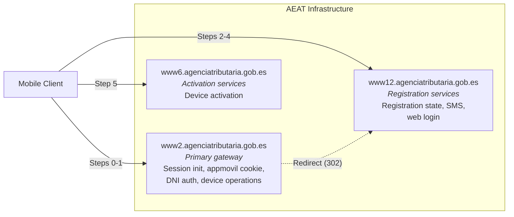

# AEAT Infrastructure

AEAT spreads the Cl@ve mobile API across several subdomains, each a separate WebSphere cluster.

## Subdomain Map

Step numbers follow the [activation flow table](../api-reference/endpoints.md#endpoint-reference-activation-flow).

## Subdomain Roles

| Subdomain | Base URL | Role |
|-----------|----------|------|
| **www2** | `https://www2.agenciatributaria.gob.es` | Main entry point: `ClaveStartingSv`, `SetCookieAppMovil`, DNI/NIE authentication (`AutenticaDniNieContrasteh`), polling, PIN, confirm/reject, QR, history, deactivation, certificate registration start, carousel. |
| **www12** | `https://www12.agenciatributaria.gob.es` | Registration and SMS: `ClaveRequestStateSv`, `ObtenerClaveMovilSMS`, `ValidarClaveMovilSMS`; phone verification and VideoID; the www12 web login (`ObtenerClaveMovil`, `ValidarClaveMovil`, `OVCT-CXEW/*`). |
| **www6** | `https://www6.agenciatributaria.gob.es` | Device activation (`ClaveActivateAuthenticationSv`). |
| **www1** | `https://www1.agenciatributaria.gob.es` | Browser pages (certificate registration, phone change, registration upgrade). |
| **sede** | `https://sede.agenciatributaria.gob.es` | AEAT public website; QR deep link `…/appclave/qrscan`. |
| **pasarela** | `https://pasarela.clave.gob.es` | Cl@ve SAML gateway (DNIe/certificate auth). |

API paths live under `/wlpl/MOVI-P24H/` (mobile operations), `/wlpl/MOVI-JDIT/` (`SetCookieAppMovil`, certificate registration, help pages) and `/wlpl/BUCV-JDIT/` (DNI/NIE identity check). See [Endpoints](../api-reference/endpoints.md).

## Cookies Across Subdomains

Each subdomain is a separate WebSphere cluster with its own `JSESSIONID`. The app avoids mixing them by **never sending `JSESSIONID` on API calls**; all other cookies go in one map sent to every host. A `JSESSIONID` from www2 sent to www6, for example, makes www6 return its homepage HTML instead of handling the API call.

See [Cookie Management](../implementation-guide/cookie-management.md) and [Request & Response Formats](../api-reference/request-response-formats.md#cookies).
