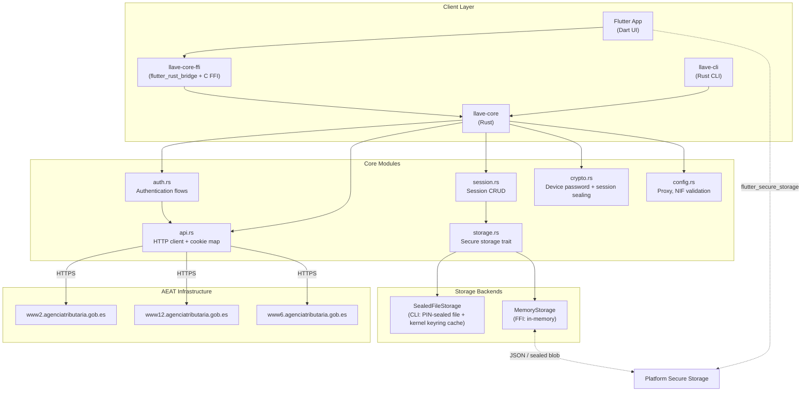

# System Overview

Llave is a layered Rust library with two frontends: a CLI and a Flutter app. It speaks the same HTTP API as the official Cl@ve app v6.2.10 (build 294).

## Architecture Diagram

## Core Modules

| Module | Responsibility |
|--------|---------------|
| `auth.rs` | Orchestrates the flows: [PIN reveal](../authentication-flows/pin-request.md), DNI/NIE + SMS activation, polling, confirm/reject, QR, history, my data, deactivation. Handles device-status codes (105/109/416), the `SetCookieAppMovil` step, and the persisted polling cursor. |
| `api.rs` | `LlaveClient`: one method per AEAT endpoint, one shared cookie map, manual [redirect handling](../implementation-guide/redirect-handling.md) (max 20 hops), JSON envelope decoding. See [Cookie Management](../implementation-guide/cookie-management.md). |
| `session.rs` | `Session` (`device_id`, `nif`, `device_password`, `poll_cursor`, …) and its [persistence](../implementation-guide/session-persistence.md). |
| `storage.rs` | `SecureStorage` trait with `SealedFileStorage` (CLI), `KeyringStorage` (its cache) and `MemoryStorage` (FFI) backends. |
| `crypto.rs` | [Device password](../cryptography/device-password.md) generation (SHA-512 of 256 random characters) and llave's own PIN-based session sealing (Argon2id + AES-256-GCM) used by the CLI and the FFI. |
| `config.rs` | Global proxy (HTTP/HTTPS/SOCKS5), config file, NIF/NIE validation, and which DNI/NIE field (`FECHA` or `SOPORTE`) a document needs. |
| `error.rs` | `LlaveError`; see [Error Codes](../api-reference/error-codes.md). |

The official app's "browser encryption" handoff does not exist in 6.2.10, and llave has no code for it.

## FFI Bridge

For Flutter, `llave-core-ffi` exposes the core through `flutter_rust_bridge` (and a C ABI). It provides:

- Session import/export as JSON across the Rust/Dart boundary
- PIN-sealed session blobs (`encrypt_session`, `decrypt_and_load_session`, `change_session_pin`)
- In-memory storage (`MemoryStorage`) that Flutter hydrates from `flutter_secure_storage` on startup
- The authentication flows as async calls, sharing one `LlaveClient` so cookies persist between calls

## Storage Backends

| Backend | Platform | Mechanism |
|---------|----------|-----------|
| `SealedFileStorage` | CLI | PIN-sealed file `$XDG_DATA_HOME/llave-cli/session.sealed`, cached in `KeyringStorage` (kernel keyring on Linux) for the current login |
| `MemoryStorage` | FFI (Flutter) | In-memory, hydrated from `flutter_secure_storage` |

llave does not copy the official app's storage (Tink AEAD + DataStore; see [Credential Storage](../cryptography/credential-storage.md)). See [Session Persistence](../implementation-guide/session-persistence.md) for the session lifecycle.
