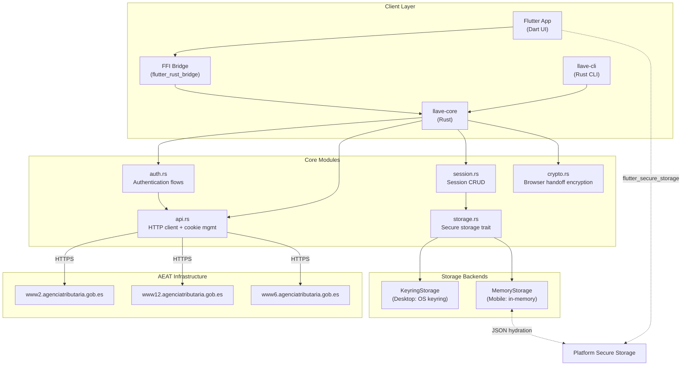

# System Overview

Llave is structured as a layered Rust library with multiple frontend targets.

## Architecture Diagram

## Core Modules

| Module | Responsibility |
|--------|---------------|
| `auth.rs` | Orchestrates all [authentication flows](../authentication-flows/pin-request.md) (PIN request, DNI+SMS activation, Cl@ve Movil confirm/reject, QR, etc.) |
| `api.rs` | HTTP client with manual [cookie management](../implementation-guide/cookie-management.md) and [redirect handling](../implementation-guide/redirect-handling.md) |
| `session.rs` | CRUD operations for [persisted sessions](../implementation-guide/session-persistence.md) |
| `storage.rs` | Trait-based storage abstraction with platform-specific backends |
| `crypto.rs` | [Browser encryption](../cryptography/browser-encryption.md) (AES-CBC) and [device password](../cryptography/device-password.md) generation |

## FFI Bridge

For mobile (Flutter) apps, the Rust core is exposed via `flutter_rust_bridge`. The FFI layer provides:

- Session import/export (JSON serialisation across the Rust/Dart boundary)
- In-memory storage (`MemoryStorage`) that is hydrated from Flutter's `flutter_secure_storage` on startup
- All authentication flow functions exposed as async FFI calls

## Storage Backends

| Backend | Platform | Mechanism |
|---------|----------|-----------|
| `KeyringStorage` | Desktop (Linux, macOS, Windows) | OS secret store (GNOME Keyring, macOS Keychain, Windows Credential Manager) |
| `MemoryStorage` | Mobile (Flutter) | In-memory `RwLock`, with JSON hydration from `flutter_secure_storage` |

See [Session Persistence](../implementation-guide/session-persistence.md) for the full session lifecycle.
