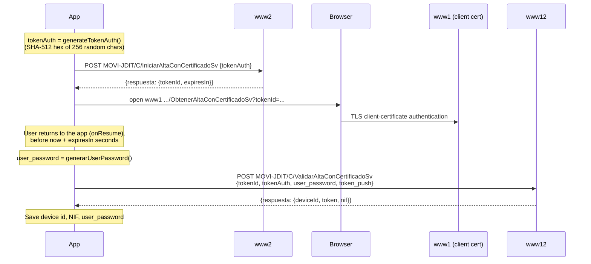

# Certificate Registration

Besides [DNI/NIE + SMS](./dni-nie-sms-activation.md), Cl@ve 6.2.10 can activate a device with an electronic certificate. It has two variants: a **certificate in the browser** (software certificate) and the **DNIe read via NFC**. llave implements neither.

## Software Certificate (Browser Hand-off)

The certificate never enters the app. The app starts a registration token, the user authenticates with their certificate **in the browser** on `www1` (the client-certificate host), and the app then collects the result.



| Step | Endpoint | Host | Body |
|------|----------|------|------|
| 1 | `MOVI-JDIT/C/IniciarAltaConCertificadoSv` | www2 | JSON `{"tokenAuth": "<128 hex>"}`. Response `{tokenId, expiresIn}` (seconds) |
| 2 | `MOVI-JDIT/C/ObtenerAltaConCertificadoSv?tokenId=<tokenId>` | www1 | Opened in the browser, where the user picks the certificate |
| 3 | `MOVI-JDIT/C/ValidarAltaConCertificadoSv` | www12 | JSON `{"tokenId", "tokenAuth", "user_password", "token_push"}`. Response `{deviceId, token, nif}` |

- These endpoints use **JSON request bodies** (`application/json; charset=UTF-8`), unlike most `MOVI-P24H` endpoints.
- `tokenAuth` uses the same algorithm as the device password (see [Device Password](../cryptography/device-password.md#generatetokenauth)).
- The response field names come from the app's Gson models, which have no `@SerializedName` annotations: `deviceId` (camelCase), `token` and `nif`.

## DNIe via NFC

The app can read the DNIe (electronic national ID) over NFC, after the user enters the card's CAN and PIN. It then uses the card's certificate for mutual TLS:

```java
// CertificadoNfcData holds the DNIe key stores and a DNIeSSLSocketFactory
certificadoNfcData.getDnieSSLSocketFactory()
// -> SecuredHttpClient.getCustomUnsafeOkHttpClient(..., certificadoNfcData)
// -> RetrofitClient.createHttpClientWithCertificate(...)
```

With the DNIe, the registration calls go to **www1** with the card's client certificate, and no SMS is involved:

| Step | Endpoint | Normal host | DNIe host |
|------|----------|-------------|-----------|
| 1 | `MOVI-P24H/ClaveRequestStateSv` | www12 | **www1** (mutual TLS) |
| 2 | `MOVI-P24H/ClaveActivateAuthenticationSv` | www6 | **www1** (mutual TLS) |

As in the SMS flow, activation happens only if `registrado == "true"`. Its form fields are the same as in the [SMS flow](./dni-nie-sms-activation.md#step-5-claveactivateauthenticationsv), with a freshly generated `user_password`. The app also uses the DNIe client for `downloadPdf`.

## Storage

Version 6.2.10 stores no certificate. A legacy `ClaveCertificados` SharedPreferences file is cleared during the migration to the Tink/DataStore store (see [Credential Storage](../cryptography/credential-storage.md)).
