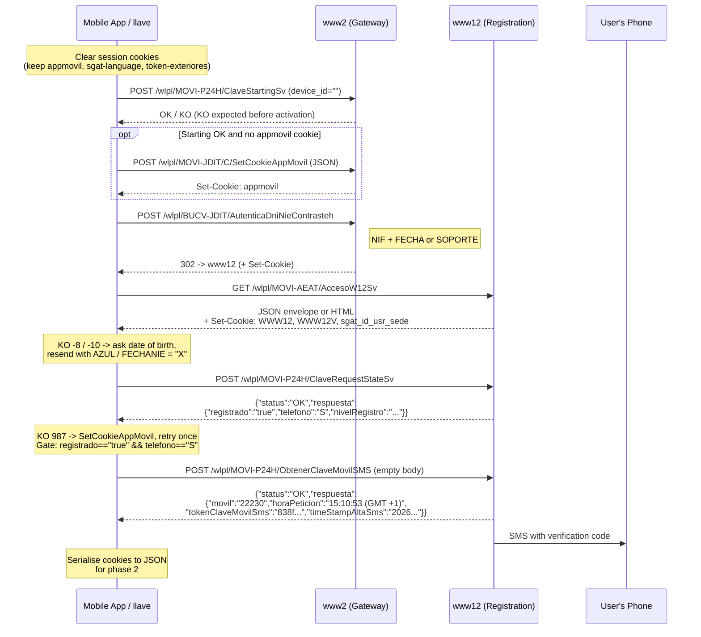
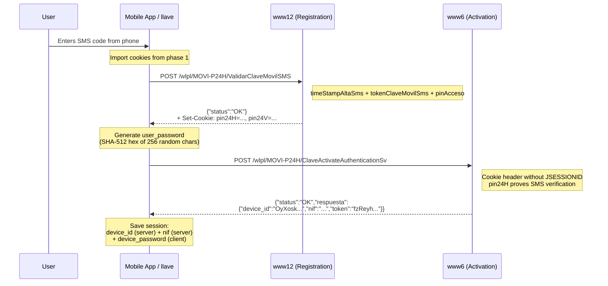
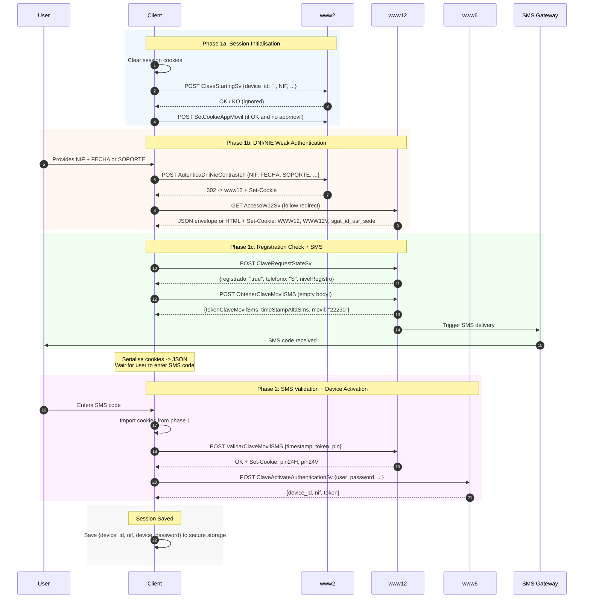
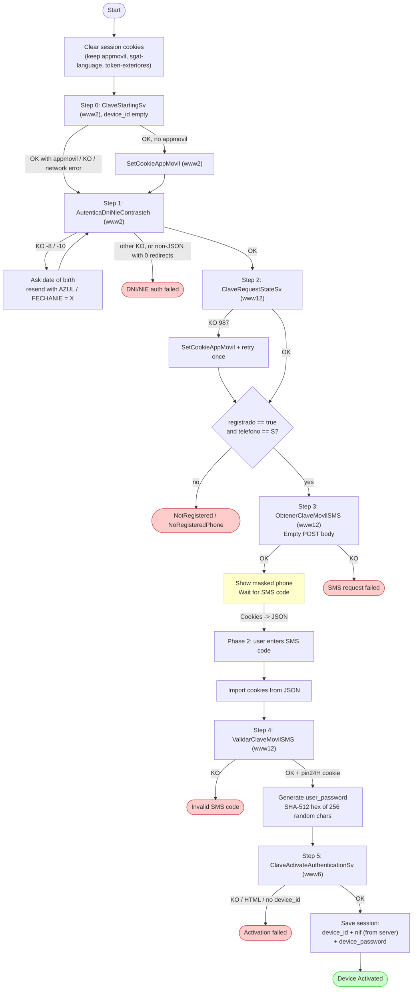

# DNI/NIE + SMS Activation

This is the main onboarding path for using Cl@ve Móvil. It uses *weak authentication* (autenticación débil): the user proves their identity with data printed on their physical DNI or NIE card, then confirms with an SMS code sent to the phone number registered in Cl@ve.

## Overview

The flow has **two phases**:

1. **Phase 1**: The DNI/NIE data establishes a session. The registration state is checked, and an SMS code is sent to the registered mobile.
2. **Phase 2**: The user enters the SMS code. The code is validated, and the device is activated (registered) with the AEAT backend.

```
┌──────────────┐     ┌──────────────┐     ┌──────────────┐
│ User's card  │     │ User's Phone │     │  AEAT Server │
│  (DNI/NIE)   │     │  (receives   │     │  (www2/www6/ │
│              │     │   SMS code)  │     │   www12)     │
└──────┬───────┘     └──────┬───────┘     └──────┬───────┘
       │                    │                    │
       │  NIF + date or     │                    │
       │  support number    │                    │
       └────────────────────┼───────────────────>│
                            │     SMS code       │
                            │<───────────────────│
                            │                    │
                            │  Enter SMS code    │
                            │───────────────────>│
                            │                    │
                            │  Device activated  │
                            │<───────────────────│
```

## Phase 1: DNI/NIE Auth + SMS Request



## Phase 2: SMS Validation + Device Activation



## Complete End-to-End Sequence



## Step-by-Step HTTP Details

No API call sends `JSESSIONID`, and every stored cookie goes to every host. See [Cookie Management](../implementation-guide/cookie-management.md).

### Step 0a: Clear Session Cookies

When the app enters its identification screen, it deletes every cookie except `appmovil`, `sgat-language` and `token-exteriores` (`RemoveSessionCookiesUseCase`). llave does the same in `auth::dni_request_sms` (`LlaveClient::clear_session_cookies`). It skips the clearing on a `-8`/`-10` resubmission.

### Step 0b: ClaveStartingSv

**Purpose**: Device context, as the app sends it at launch. An app that is not yet activated has no device id and sends it **empty**.

| Property | Value |
|----------|-------|
| **Method** | `POST` |
| **URL** | `https://www2.agenciatributaria.gob.es/wlpl/MOVI-P24H/ClaveStartingSv` |
| **Content-Type** | `application/x-www-form-urlencoded` |

**Form Parameters**:

| Parameter | Description | Example |
|-----------|-------------|---------|
| `device_id` | Stored device id; **empty** before activation | `""` |
| `NIF` | User's tax ID | `09030055W` |
| `sistema_operativo` | OS identifier | `A` (Android) |
| `token_push` | Firebase token (llave: empty) | `""` |
| `version_os` | OS version | `14` |
| `version_app` | App version | `6.2.10` |
| `modelo` | Manufacturer + model | `Samsung SM-S928U` |

A `KO` response (e.g. `105`) is expected before activation, and llave ignores it here. If the response is `OK` and there is no `appmovil` cookie, the app calls **SetCookieAppMovil**:

| Property | Value |
|----------|-------|
| **Method** | `POST` |
| **URL** | `https://www2.agenciatributaria.gob.es/wlpl/MOVI-JDIT/C/SetCookieAppMovil` |
| **Content-Type** | `application/json; charset=UTF-8` |
| **Body** | `{"version_app":"6.2.10","sistema_operativo":"A","version_os":"14","modelo":"Samsung SM-S928U"}` |

The `appmovil` cookie is Base64-encoded JSON that describes the client (app, `version_app`, `sistema_operativo`, `version_os`, `modelo`).

### Step 1: AutenticaDniNieContrasteh

**Purpose**: Weak authentication with the card data. The cookies set along the redirect chain (`WWW12`, `WWW12V`, `sgat_id_usr_sede`) carry the session into the next steps.

| Property | Value |
|----------|-------|
| **Method** | `POST` |
| **URL** | `https://www2.agenciatributaria.gob.es/wlpl/BUCV-JDIT/AutenticaDniNieContrasteh?ref=%2Fwlpl%2FMOVI-AEAT%2FAccesoW12Sv` |
| **Content-Type** | `application/x-www-form-urlencoded` |

**Form Parameters**:

| Parameter | Value | Description |
|-----------|-------|-------------|
| `NIF` | e.g. `09030055W` | DNI/NIE number |
| `FECHA` | `DD-MM-YYYY` or `""` | Depends on the document type (see below) |
| `SOPORTE` | e.g. `E12345678` or `""` | Depends on the document type (see below) |
| `botonAutenticacionDebil` | `Continuar` | Literal; identifies weak auth |
| `APP` | `S` | Mobile app context |
| `modo` | `json` | Asks for the JSON envelope |
| `AZUL` | `""` or `"X"` | `"X"` when resending after KO `-8` |
| `FECHANIE` | `""` or `"X"` | `"X"` when resending after KO `-10` |

**FECHA / SOPORTE by document type**: the app shows, and sends, only one field. The other is sent empty (llave: `config::required_dni_input`).

| Document | First character | `FECHA` | `SOPORTE` |
|----------|-----------------|---------|-----------|
| DNI | digit | Card **validity date** | `""` |
| DNI (special) | `K`, `L` | **Date of birth** | `""` |
| NIE | `X`, `Y`, `Z` | `""` | Card **support number** |
| NIE (special) | `M` | **Date of birth** | `""` |

**Response handling**:

1. Follow redirects manually, reusing the original `Cookie` header and capturing `Set-Cookie` at every hop. See [Redirect Handling](../implementation-guide/redirect-handling.md).
2. Parse the final body as the standard JSON envelope `{status, codigo_error, mensaje, ...}`, as the app does:
   - `OK`: authenticated.
   - `KO -8`: the server wants the date of birth. Ask for it and resend with `FECHA=<birth date>`, `SOPORTE=""`, `AZUL="X"`.
   - `KO -10`: same, but resend with `FECHANIE="X"`.
   - Other `KO`: API error.
3. If the body is **not** JSON, llave falls back to its older heuristic: zero redirects means the credentials were rejected (`DniAuthFailed`). The app treats a non-JSON body as success.

llave returns `LlaveError::DniBirthDateRequired { challenge, message }` for `-8`/`-10`. The CLI then prompts for the date of birth and calls `dni_request_sms` again with the challenge.

### Step 2: ClaveRequestStateSv

**Purpose**: Check the user's Cl@ve registration after DNI/NIE auth.

| Property | Value |
|----------|-------|
| **Method** | `POST` |
| **URL** | `https://www12.agenciatributaria.gob.es/wlpl/MOVI-P24H/ClaveRequestStateSv` |
| **Content-Type** | `application/x-www-form-urlencoded` |

**Form Parameters**: `sistema_operativo=A`, `version_os=14`, `version_app=6.2.10`. No `device_id` or `NIF` is sent: the server identifies the user from the session cookies.

- **KO `987`**: the app calls `SetCookieAppMovil` and retries **once**. llave does the same. The exact meaning of `987` is undocumented; it is presumably a missing or invalid `appmovil` cookie.
- **Registration gate**: the app requests the SMS only when `registrado == "true"` **and** `telefono == "S"`. Otherwise llave fails with `NotRegistered` or `NoRegisteredPhone`. The user must register, or register a phone, with Cl@ve first.

See [ClaveRequestStateSv payload](../api-reference/request-response-formats.md#claverequeststatesv).

### Step 3: ObtenerClaveMovilSMS

**Purpose**: Send an SMS verification code to the registered phone.

| Property | Value |
|----------|-------|
| **Method** | `POST` |
| **URL** | `https://www12.agenciatributaria.gob.es/wlpl/MOVI-P24H/ObtenerClaveMovilSMS` |
| **Content-Type** | **None** (empty body) |

> **Critical**: This endpoint **must** get an **empty POST body** and
> **no Content-Type header**, like Retrofit `@POST` without `@Body`. Sending
> form-encoded data (even empty) causes [error 902024](../api-reference/error-codes.md).

The response is `{movil, horaPeticion, tokenClaveMovilSms, timeStampAltaSms}`; `movil` is a masked phone number. See [ObtenerClaveMovilSMS payload](../api-reference/request-response-formats.md#obtenerclavemovilsms).

**Phase 1 ends here.** llave serialises the cookie map to JSON (`export_cookies`) so phase 2 can resume after the user types the code.

### Step 4: ValidarClaveMovilSMS

**Purpose**: Validate the SMS code. On success, the server sets `pin24H` and `pin24V`.

| Property | Value |
|----------|-------|
| **Method** | `POST` |
| **URL** | `https://www12.agenciatributaria.gob.es/wlpl/MOVI-P24H/ValidarClaveMovilSMS` |
| **Content-Type** | `application/x-www-form-urlencoded` |

| Parameter | Description | Example |
|-----------|-------------|---------|
| `timeStampAltaSms` | From step 3 | `20260310151053593031` |
| `tokenClaveMovilSms` | From step 3 | `838f5824490558cc6c456e550ae7b6c2...` |
| `pinAcceso` | SMS code typed by the user | `123456` |

> The `pin24H` cookie is the gate for device activation. Without it, step 5
> returns HTML instead of JSON. The app skips this step if a `pin24H` cookie is
> already stored; llave always runs it.

### Step 5: ClaveActivateAuthenticationSv

**Purpose**: Register the device. The server assigns `device_id`.

| Property | Value |
|----------|-------|
| **Method** | `POST` |
| **URL** | `https://www6.agenciatributaria.gob.es/wlpl/MOVI-P24H/ClaveActivateAuthenticationSv` |
| **Content-Type** | `application/x-www-form-urlencoded` |

| Parameter | Description | Example |
|-----------|-------------|---------|
| `sistema_operativo` | OS identifier | `A` |
| `version_os` | OS version | `14` |
| `version_app` | App version | `6.2.10` |
| `token_push` | Firebase token (llave: empty) | `""` |
| `user_password` | Client-generated [device password](../cryptography/device-password.md): 128 uppercase hex chars | `3F9A...C01E` |
| `modelo` | Manufacturer + model | `Samsung SM-S928U` |

No `device_id` or `NIF` is sent. The cookies (`WWW12`, `WWW12V`, `pin24H`, `pin24V`, `appmovil`, `sgat-language`, `sgat_id_usr_sede`; never `JSESSIONID`) identify the user.

**Response**: `respuesta` contains **only** `device_id`, `nif` and `token`. There is no `user_password`; the password is the one the client generated. See [ClaveActivateAuthenticationSv payload](../api-reference/request-response-formats.md#claveactivateauthenticationsv).

After activation, llave (`auth::session_from_activation`):

- requires a non-empty `device_id` and fails otherwise, like the app's `checkNotNull`;
- stores the **NIF returned by the server**, falling back to the typed NIF only when the response has none;
- stores the locally generated password.

```json
{
  "device_id": "OyXoskiz6fLnzd080Xxzrpr40",
  "nif": "09030055W",
  "device_password": "3F9A…(128 uppercase hex chars)…C01E",
  "firebase_token": null,
  "created_at": "2026-03-10T14:11:16.999Z",
  "poll_cursor": null
}
```

See [Session Persistence](../implementation-guide/session-persistence.md).

## Data Flow Diagram



## Key Points

- The device password is generated **client-side** before activation. It is a SHA-512 uppercase hex digest, not a UUID (see [Device Password](../cryptography/device-password.md)).
- `device_id` is assigned **server-side**. Before activation, `ClaveStartingSv` gets an empty `device_id`.
- The `token` in the activation response is a session/push token, **not** the device password.
- Store the `nif` the server returns.
- Cookies must survive between phase 1 and phase 2 (see [Cookie Management](../implementation-guide/cookie-management.md)).
- CLI: `llave activate -n <NIF> -f <DD-MM-YYYY>` (DNI, DNI K/L, NIE M) or `llave activate -n <NIE> -s <support number>` (NIE X/Y/Z).
