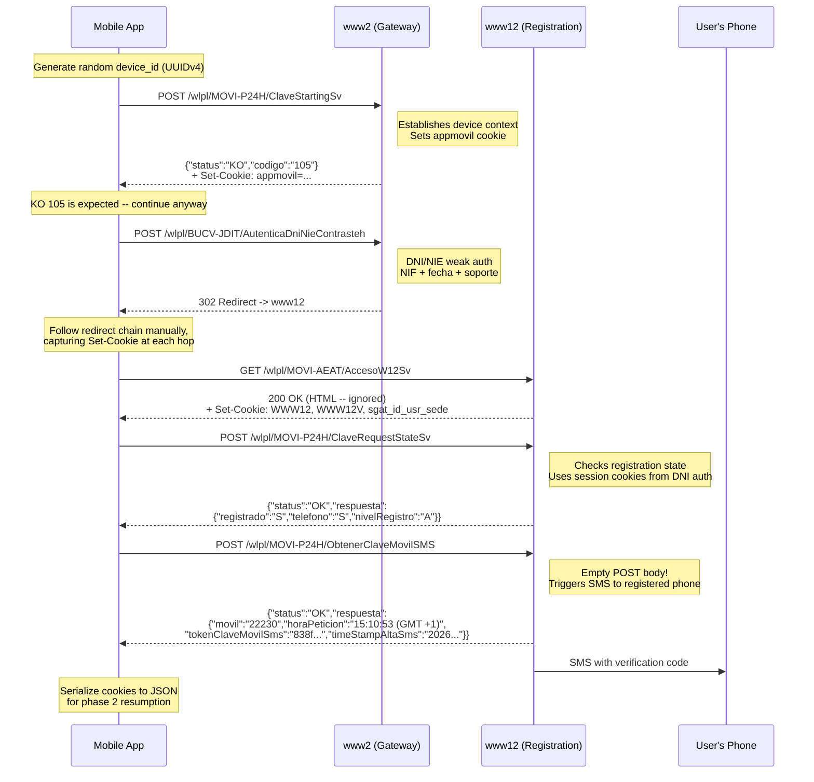
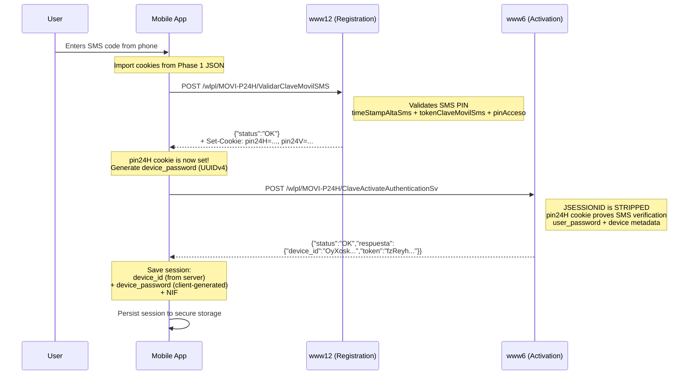
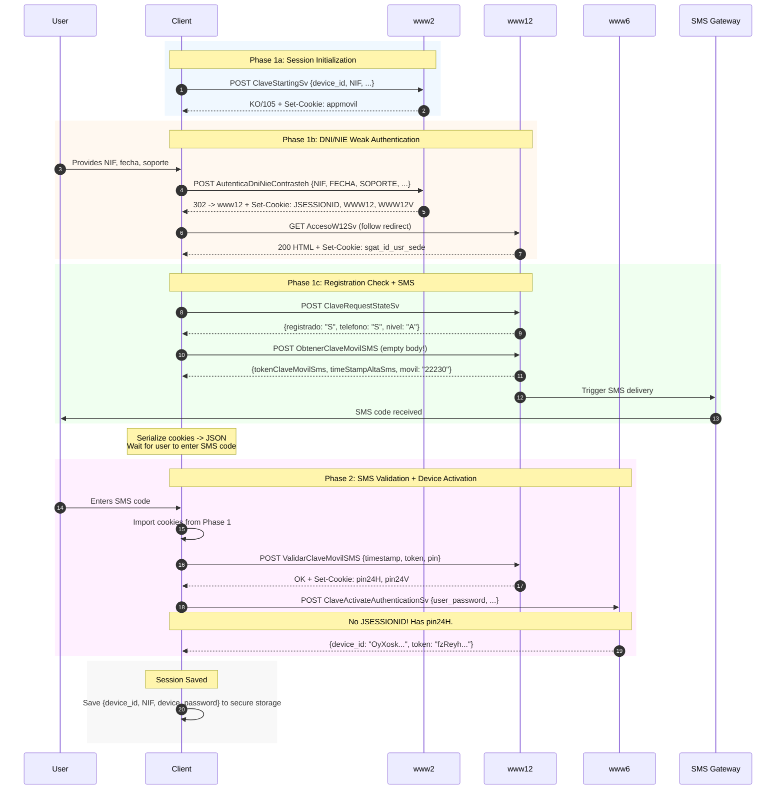
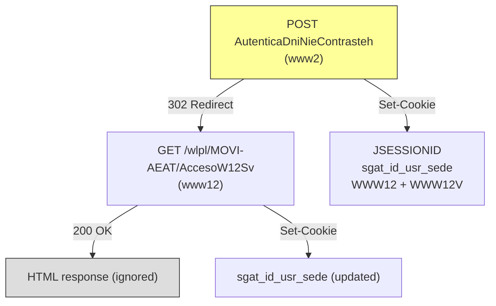
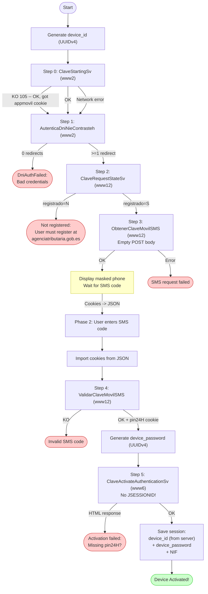

# DNI/NIE + SMS Activation

This is the primary onboarding path for Spanish taxpayers who want to use the Clave Movil system. It uses *weak authentication* (autenticacion debil) -- identity proven via data printed on a physical DNI or NIE card, combined with SMS verification to the registered phone number.

## Overview

The flow has **two phases**:

1. **Phase 1** -- DNI/NIE credentials establish a session, then an SMS code is sent to the registered mobile.
2. **Phase 2** -- The user enters the SMS code, which is validated, and then the device is activated (registered) with the AEAT backend.

```
┌──────────────┐     ┌──────────────┐     ┌──────────────┐
│  User's DNI  │     │ User's Phone │     │  AEAT Server │
│  (physical)  │     │  (receives   │     │  (www2/www6/ │
│              │     │   SMS code)  │     │   www12)     │
└──────┬───────┘     └──────┬───────┘     └──────┬───────┘
       │                    │                    │
       │  NIF + date +      │                    │
       │  soporte number    │                    │
       └────────────────────┼───────────────────>│
                            │     SMS code       │
                            │<───────────────────│
                            │                    │
                            │  Enter SMS code    │
                            │───────────────────>│
                            │                    │
                            │  Device activated  │
                            │<───────────────────│
```

## Phase 1: DNI/NIE Auth + SMS Request



## Phase 2: SMS Validation + Device Activation



## Complete End-to-End Sequence



## Step-by-Step HTTP Details

### Step 0: ClaveStartingSv

**Purpose**: Establish device context with the AEAT backend. Sets the `appmovil` cookie, which is required by subsequent endpoints.

| Property | Value |
|----------|-------|
| **Method** | `POST` |
| **URL** | `https://www2.agenciatributaria.gob.es/wlpl/MOVI-P24H/ClaveStartingSv` |
| **Content-Type** | `application/x-www-form-urlencoded` |
| **Required Cookies** | `sgat-language` (pre-seeded) |

**Form Parameters**:

| Parameter | Description | Example |
|-----------|-------------|---------|
| `device_id` | Random UUIDv4 | `601a4147-fcd3-4c6a-9a9d-e627ca86deb8` |
| `NIF` | User's tax ID | `09030055W` |
| `sistema_operativo` | OS identifier | `A` (Android) |
| `token_push` | Firebase push token | `""` (empty for initial setup) |
| `version_os` | OS version | `14` |
| `version_app` | App version | `6.2.5` |
| `modelo` | Device model | `SM-S928U` |

**Response**: JSON with `status` field.

```json
{
  "status": "KO",
  "codigo_error": "105",
  "mensaje": "?",
  "visible": "N",
  "crashlytics": "N"
}
```

> A `KO` response with code `105` is **expected and normal** during initial
> registration. The important side effect is the `appmovil` Set-Cookie header.
> The flow continues regardless of this response status.

**Cookies Set**: `appmovil` (Base64-encoded JSON):

```json
{
  "app": "clave",
  "version_app": "6.2.5",
  "sistema_operativo": "A",
  "version_os": "14",
  "modelo": "SM-S928U"
}
```

### Step 1: AutenticaDniNieContrasteh

**Purpose**: Authenticate using DNI/NIE card data. This is the "weak authentication" step -- it proves the caller has the physical card's printed data. The response body is HTML and is completely ignored. Only the **cookies set during the redirect chain** matter.

| Property | Value |
|----------|-------|
| **Method** | `POST` |
| **URL** | `https://www2.agenciatributaria.gob.es/wlpl/BUCV-JDIT/AutenticaDniNieContrasteh?ref=%2Fwlpl%2FMOVI-AEAT%2FAccesoW12Sv` |
| **Content-Type** | `application/x-www-form-urlencoded` |
| **Required Cookies** | `sgat-language`, `appmovil` |

**Form Parameters**:

| Parameter | Value | Description |
|-----------|-------|-------------|
| `NIF` | e.g. `09030055W` | Spanish tax ID number |
| `FECHA` | e.g. `15-06-2025` | Date of validity (DNI) or date of birth (NIE), format `DD-MM-YYYY` |
| `SOPORTE` | e.g. `BAA123456` | Support/serial number from the physical card |
| `botonAutenticacionDebil` | `Continuar` | Literal string -- identifies this as weak auth |
| `APP` | `S` | Indicates mobile app context |
| `modo` | `json` | Request JSON-mode (though response is still HTML) |
| `AZUL` | `""` | Empty -- reserved for certificate auth |
| `FECHANIE` | `""` | Empty -- reserved for NIE-specific date |

**Response Handling**:

This endpoint **does not return JSON**. It returns HTML and triggers a redirect chain. The client must:

1. **Disable automatic redirects** (reqwest's auto-redirect strips custom headers on cross-origin redirects).
2. **Follow each redirect manually**, re-attaching `Cookie` and `TrazasApp` headers at every hop.
3. **Capture `Set-Cookie` headers** from every response in the chain.
4. **Count redirects** -- zero redirects means auth failed (server returned the login form again).

See [Redirect Handling](../implementation-guide/redirect-handling.md) for full details.

**Redirect Chain**:



**Cookies Set During Redirect Chain**:
- `JSESSIONID` -- www2 WebSphere session
- `WWW12` -- Authentication token (long encrypted string)
- `WWW12V` -- Timestamp for WWW12 (format: `YYYYMMDD-HHmmssSSS`)
- `sgat_id_usr_sede` -- URL-encoded JSON with session info

**Failure Detection**: If the redirect count is 0, the server returned the login form again, meaning the credentials (NIF, fecha, or soporte) were rejected.

### Step 2: ClaveRequestStateSv

**Purpose**: Check the user's registration state after DNI authentication.

| Property | Value |
|----------|-------|
| **Method** | `POST` |
| **URL** | `https://www12.agenciatributaria.gob.es/wlpl/MOVI-P24H/ClaveRequestStateSv` |
| **Content-Type** | `application/x-www-form-urlencoded` |
| **Required Cookies** | All cookies from Steps 0-1 (especially `WWW12`, `WWW12V`, `sgat_id_usr_sede`) |

**Form Parameters**:

| Parameter | Value | Description |
|-----------|-------|-------------|
| `sistema_operativo` | `A` | Android |
| `version_os` | `14` | OS version |
| `version_app` | `6.2.5` | App version |

> No `device_id` or `NIF` is sent. The server identifies the user entirely from
> the session cookies established by DNI authentication.

**Response**: See [ClaveRequestStateSv payload](../api-reference/request-response-formats.md#claverequeststatessv).

### Step 3: ObtenerClaveMovilSMS

**Purpose**: Trigger an SMS verification code to the user's registered phone number.

| Property | Value |
|----------|-------|
| **Method** | `POST` |
| **URL** | `https://www12.agenciatributaria.gob.es/wlpl/MOVI-P24H/ObtenerClaveMovilSMS` |
| **Content-Type** | **None** (empty body) |
| **Required Cookies** | All cookies from Steps 0-2 |

> **Critical**: This endpoint **must** be called with an **empty POST body** and
> **no Content-Type header**. Sending form-encoded data (even empty) causes
> [error 902024](../api-reference/error-codes.md).

**Request Body**: Empty string (`""`) -- produces `Content-Length: 0`.

**Response**: See [ObtenerClaveMovilSMS payload](../api-reference/request-response-formats.md#obtenerclavemovilsms).

At this point, the user's phone receives an SMS with a verification code.

**Phase 1 ends here.** The client serialises all cookies to JSON so they can be restored in Phase 2. See [Cookie Management](../implementation-guide/cookie-management.md) for serialisation details.

### Step 4: ValidarClaveMovilSMS

**Purpose**: Validate the SMS code entered by the user. On success, the server sets the `pin24H` and `pin24V` cookies.

| Property | Value |
|----------|-------|
| **Method** | `POST` |
| **URL** | `https://www12.agenciatributaria.gob.es/wlpl/MOVI-P24H/ValidarClaveMovilSMS` |
| **Content-Type** | `application/x-www-form-urlencoded` |
| **Required Cookies** | All cookies from Phase 1 (imported from serialised JSON) |

**Form Parameters**:

| Parameter | Description | Example |
|-----------|-------------|---------|
| `timeStampAltaSms` | Server timestamp from Step 3 | `20260310151053593031` |
| `tokenClaveMovilSms` | SMS session token from Step 3 | `838f5824490558cc6c456e550ae7b6c2...` |
| `pinAcceso` | The SMS code entered by the user | `123456` |

**Cookies Set**:
- `pin24H` -- Long encrypted token proving SMS verification
- `pin24V` -- Timestamp companion (format: `YYYYMMDD-HHmmssSSS`)
- `JSESSIONID` -- New session ID for www12

> **This is the pivotal step.** The `pin24H` cookie is the "gate" that allows
> device activation. Without it, Step 5 will return HTML instead of JSON.

### Step 5: ClaveActivateAuthenticationSv

**Purpose**: Activate (register) the device with the AEAT backend. Returns a server-generated `device_id`.

| Property | Value |
|----------|-------|
| **Method** | `POST` |
| **URL** | `https://www6.agenciatributaria.gob.es/wlpl/MOVI-P24H/ClaveActivateAuthenticationSv` |
| **Content-Type** | `application/x-www-form-urlencoded` |
| **Required Cookies** | All cookies **except JSESSIONID** |

> **Critical**: The `JSESSIONID` from www2/www12 **must be explicitly excluded**.
> See [Cookie Management](../implementation-guide/cookie-management.md) for why.

**Form Parameters**:

| Parameter | Description | Example |
|-----------|-------------|---------|
| `sistema_operativo` | OS identifier | `A` |
| `version_os` | OS version | `14` |
| `version_app` | App version | `6.2.5` |
| `token_push` | Firebase push token | `""` (empty) |
| `user_password` | Client-generated password | `a1b2c3d4-...` |
| `modelo` | Device model | `SM-S928U` |

**Required Cookies**:

```
Cookie: sgat-language=es_ES;
        sgat_id_usr_sede={...};
        appmovil={base64};
        WWW12={encrypted};
        WWW12V={timestamp};
        pin24H={encrypted};    <- REQUIRED (proves SMS was verified)
        pin24V={timestamp}     <- REQUIRED (companion to pin24H)
```

**Response**: See [ClaveActivateAuthenticationSv payload](../api-reference/request-response-formats.md#claveactivateauthenticationsv).

**After activation**, the session is saved:

```json
{
  "device_id": "OyXoskiz6fLnzd080Xxzrpr40",
  "nif": "09030055W",
  "device_password": "a1b2c3d4-e5f6-7890-abcd-ef1234567890",
  "firebase_token": null,
  "created_at": "2026-03-10T14:11:16.999Z"
}
```

See [Session Persistence](../implementation-guide/session-persistence.md) for storage details.

## Data Flow Diagram



## Key Points

- The `device_password` is generated **client-side** before the activation call (see [Device Password](../cryptography/device-password.md))
- The `device_id` is generated **server-side** and returned in the response
- The `user_password` form field in step 5 contains the client-generated `device_password`
- The `token` field in the response is a session/push token, NOT the device password
- Cookies must be serialised between Phase 1 and Phase 2 (see [Cookie Management](../implementation-guide/cookie-management.md))
- `JSESSIONID` must be stripped before calling www6 (see [Cookie Management](../implementation-guide/cookie-management.md))
