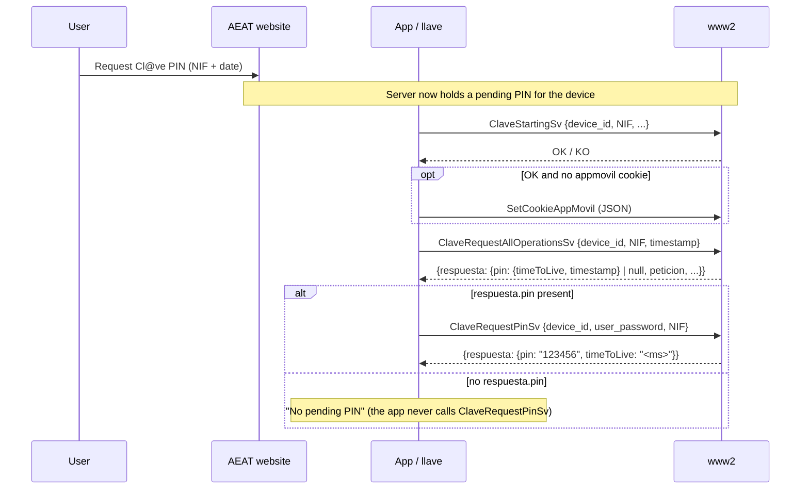

# PIN Request

A Cl@ve PIN is **started on the AEAT website**, not in the app. The user asks for a PIN on a government login page (NIF plus a date). The server then holds a pending PIN for the activated device. The app only **reveals** that pending PIN. `ClaveRequestPinSv` does not create one.

## Flow



```
1. ClaveStartingSv              -> device_id, NIF, sistema_operativo, token_push, version_os, version_app, modelo
                                   OK  -> if no `appmovil` cookie, call SetCookieAppMovil
                                   KO 105/109 -> device revoked: wipe local session, stop
                                   KO 416     -> device not active: stop (no wipe)

2. ClaveRequestAllOperationsSv  -> device_id, NIF, timestamp (poll cursor), OS info
                                   respuesta.pin == null -> no pending PIN, stop
                                   Errors 105/109/416 handled as in step 1

3. ClaveRequestPinSv            -> device_id, user_password, NIF, OS info
                                   OK  -> { pin, timeToLive }
                                   KO 307 -> no valid PIN (e.g. it expired between steps 2 and 3)
```

The official app also asks for biometric/device unlock before step 3 (`accederPin`). It shows "Actualmente no tiene pendiente ningún PIN" when step 2 has no `pin`.

## `timeToLive` Is in Milliseconds

The app passes `timeToLive` straight to `CountDownTimer(millisInFuture)`. For example, `"120000"` means 2 minutes. llave converts it to whole seconds (`ttl_ms_to_seconds`), and the CLI prints that value as `time_to_live_seconds`.

## Error Codes

| Code | Where | Meaning | Action |
|------|-------|---------|--------|
| `105`, `109` | Starting, AllOperations | Device revoked / not registered | Delete the local session (app and llave). Re-activation required. |
| `416` | Starting, AllOperations | Device not active | Stop. **Do not** delete the local session. |
| `307` | `ClaveRequestPinSv` | "No tiene disponible ningún PIN": no valid PIN | Report "no pending PIN" |
| `500600` | any | App version outdated | Update `version_app` / User-Agent |

See [Error Codes](../api-reference/error-codes.md) for the full list.

## llave

`auth::request_pin` runs the three steps above:

- It fails with `LlaveError::NoPendingPin` when `respuesta.pin` is absent, or when `ClaveRequestPinSv` answers `307`.
- It fails with `LlaveError::DeviceNotActive` on `105`/`109`/`416`. For `105`/`109` it deletes the stored session first.
- It advances and persists the [poll cursor](./pending-operations-polling.md#timestamp-cursor) from `respuesta.peticion.timestamp`.

The CLI equivalent is `llave pin`. Start the PIN request on the AEAT website first.

## Key Points

- PINs are generated **server-side**, on request from the website. There is no local OTP (TOTP/HOTP).
- Reveal the PIN only when `ClaveRequestAllOperationsSv` reports `respuesta.pin`.
- `ClaveRequestPinSv` needs `device_id` (server-generated) plus `user_password` (client-generated). See [Device Password](../cryptography/device-password.md).
