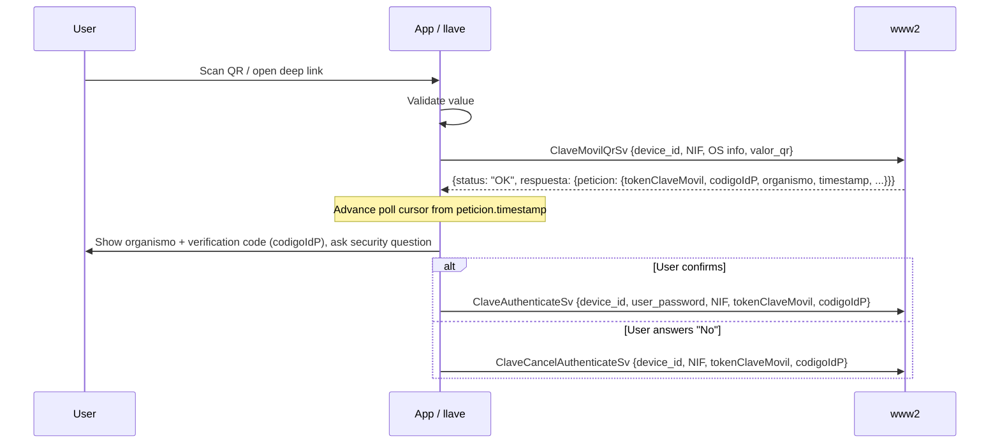

# QR Code Authentication

Some government login pages show a QR code. Scanning it with the app creates a pending Cl@ve Móvil request, which the user must then **confirm or reject** like any other request.

## Input

The app accepts the QR text from its camera, or a deep link (declared in `AndroidManifest`):

```
https://sede.agenciatributaria.gob.es/appclave/qrscan?qrcode=<value>
```

For the deep link, the value is everything after `qrcode=`, taken from the raw query **without percent-decoding** (llave: `auth::qr_value_from_input`).

## Validation

Before calling the server, the app checks the value (llave: `auth::is_valid_qr`):

1. It starts with `"0"`.
2. The rest is Base64 that decodes to a length divisible by 8. Android `Base64.DEFAULT` is used, so padding is optional.
3. The whole value is at least 152 characters long.

Invalid codes are rejected locally (llave: `LlaveError::InvalidQr`).

## Flow



## Details

- `valor_qr` is sent exactly as validated; no other processing is applied.
- The request is in `respuesta.peticion`, not directly in `respuesta`. A response with no `peticion.tokenClaveMovil` contains nothing to confirm.
- The confirm and reject steps match [Clave Movil](./clave-movil.md#confirm-flow), including the security check.
- CLI: `llave qr --value '<value or deep link>'`. It shows the organisation and verification code, then asks; "no" rejects. `--yes` skips the prompt.
- Flutter: the QR screen shows the same security check as a pending request (organisation, verification code, "did you start this?"); "No" rejects.
