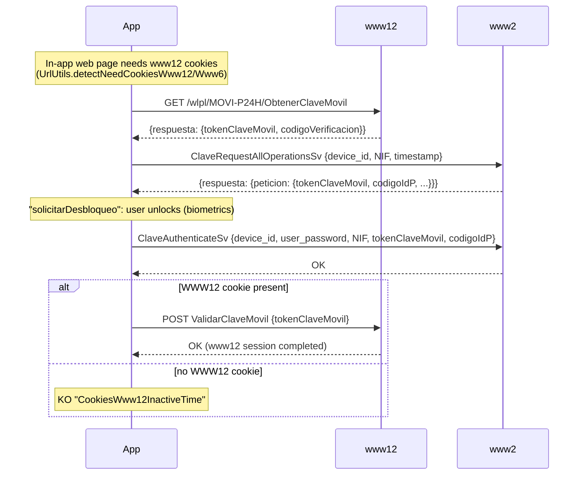

# www12 Web Login (ObtenerClaveMovil)

> Older versions of this book called this page "Token Activation" and said `ObtenerClaveMovil`/`ValidarClaveMovil` activate a device with a pre-existing token. **No such flow exists in Cl@ve 6.2.10.** A device is activated only through [DNI/NIE + SMS](./dni-nie-sms-activation.md), a [certificate](./certificate-registration.md) or VideoID.

`ObtenerClaveMovil` and `ValidarClaveMovil` are how the app **signs itself in to the AEAT website (www12)** with its own Cl@ve Móvil. It does this when an AEAT web service that needs a www12 (or www6) session is opened inside the app's WebView, such as a `www12.agenciatributaria.gob.es` page opened from the app menu. In effect, the app creates a Cl@ve Móvil request for itself and then confirms it.

## Flow

| Step | Endpoint | Host | Body |
|------|----------|------|------|
| 1 | `ObtenerClaveMovil` | www12 | `GET`, no body. Response `{tokenClaveMovil, codigoVerificacion}` |
| 2 | `ClaveRequestAllOperationsSv` | www2 | form: `device_id`, `NIF`, `timestamp`, OS info. Returns the request just created. |
| 3 | `ClaveAuthenticateSv` | www2 | form: `device_id`, `user_password`, `NIF`, `tokenClaveMovil`, `codigoIdP`, OS info |
| 4 | `ValidarClaveMovil` | www12 | form: `tokenClaveMovil`. Only if a `WWW12` cookie is stored |

Steps 3–4 are the app's `BaseViewModel.confirmarPeticionAutenticacionAndContinue`. Step 2 also advances the stored poll cursor (`saveUltimaPeticionClaveMovil`). The app has a QR variant, `ObtenerClaveMovilQR` (www2), which llave does not implement.

## llave

llave does not implement step 1: there is no in-app web session to unlock. Its [confirm flow](./clave-movil.md#confirm-flow) mirrors `confirmarPeticionAutenticacionAndContinue` (steps 3–4). When no `WWW12` cookie exists, which is the normal case in the CLI, it skips `ValidarClaveMovil` and does not raise an error.
