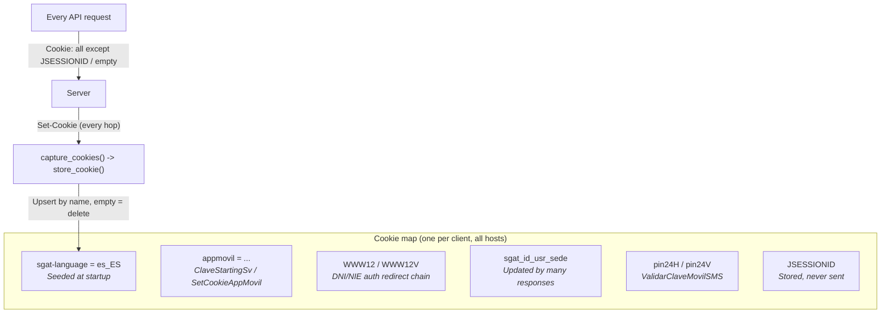
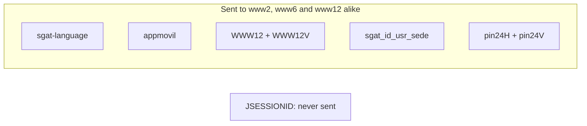

# Cookie Management

The client manages cookies **by hand** across all AEAT subdomains (www2, www6, www12):

1. The app keeps **one cookie map** (`map_cookies`, keyed by cookie name) and builds an explicit `Cookie` header for every request from it (`Repository.recuperarCookies`). Cookies are not scoped per domain.
2. Standard HTTP clients (like reqwest's cookie store) follow RFC domain matching, so cookies set by `www2` would never reach `www6` or `www12`.
3. The server relies on this forwarding. For example, `WWW12`/`WWW12V` from DNI/NIE auth and `pin24H`/`pin24V` from www12 must reach www6 for activation.

## Cookie Map Semantics

llave's `LlaveClient` keeps an ordered `Vec<(name, value)>` that mirrors the app's map:

| Operation | Rule |
|-----------|------|
| Store (`Set-Cookie`) | Upsert by **name**. An empty value or a literal `""` **deletes** the cookie, like `Repository.saveListCookiesInLocal` (server-side removal) |
| Send | Every stored cookie goes to **every** host, **except `JSESSIONID`** and empty values (`build_cookie_header`) |
| Seed | `sgat-language=es_ES` at client creation (the app uses `en_GB` for English). The app would also seed `token-exteriores` from `BuildConfig.TOKEN_EXTERIORES`, which is `null` in 6.2.10 |
| Clear session | Keep only `appmovil`, `sgat-language`, `token-exteriores` (`RemoveSessionCookiesUseCase`; llave: `clear_session_cookies`). Done when entering DNI/NIE identification |

## Key Cookies

| Cookie | Set By | Purpose | Needed For |
|--------|--------|---------|------------|
| `sgat-language` | Seeded by the client | Language (`es_ES`) | All requests |
| `appmovil` | `ClaveStartingSv`, or `SetCookieAppMovil` when missing | Base64 JSON describing app version, OS and `modelo` | Subsequent requests; `ClaveRequestStateSv` answers `987` without it (presumed) |
| `token-exteriores` | Client (`BuildConfig`) | Unset in 6.2.10 | — |
| `JSESSIONID` | www2/www12 WebSphere | Session affinity | **Never sent** by any API call |
| `WWW12` / `WWW12V` | DNI/NIE auth redirect chain | www12 authentication token + timestamp | www12 and www6 endpoints; `ValidarClaveMovil` |
| `sgat_id_usr_sede` | Many responses | URL-encoded JSON session info | Informational |
| `pin24H` / `pin24V` | `ValidarClaveMovilSMS` | Proof of SMS verification + timestamp | **Device activation on www6** |

## JSESSIONID Stripping

The app **never sends `JSESSIONID` in an API call**. `Repository.recuperarCookies(requireJsessionId = false)` is used by all 31 call sites and skips it; only the PDF download can include it. This was confirmed in smali.

llave follows the same rule for every request, not only www6 (`build_cookie_header`). Each subdomain runs its own WebSphere cluster, and a foreign `JSESSIONID` made www6 return HTML instead of JSON. See [AEAT Infrastructure](../architecture/aeat-infrastructure.md).

## Cookie Propagation

## Cookie Lifecycle

Which cookies exist at each step of the [DNI/NIE + SMS activation flow](../authentication-flows/dni-nie-sms-activation.md):

```mermaid
gantt
    title Cookie Lifecycle During Activation
    dateFormat X
    axisFormat %s

    section sgat-language
    Seeded at startup           :active, 0, 6

    section appmovil
    Starting / SetCookieAppMovil :active, 1, 6

    section JSESSIONID
    Stored, never sent          :crit, 2, 6

    section WWW12 + WWW12V
    Set during DNI redirect     :active, 2, 6

    section sgat_id_usr_sede
    Set during DNI redirect     :active, 2, 6

    section pin24H + pin24V
    Set by SMS validation       :active, 4, 6

    section Step Markers
    0 Clear + ClaveStartingSv   :milestone, 0, 0
    1 AutenticaDniNie           :milestone, 1, 1
    2 ClaveRequestState         :milestone, 2, 2
    3 ObtenerSMS                :milestone, 3, 3
    4 ValidarSMS                :milestone, 4, 4
    5 ActivateAuth              :milestone, 5, 5
```

## Redirect Chains

llave captures `Set-Cookie` from **every** hop of a redirect chain. The app's `RedirectInterceptor` saves the cookies of only one response in the chain. llave's set is therefore a superset; the two would differ only if an intermediate hop set a cookie that a later hop does not overwrite. Every hop reuses the request's original `Cookie` header (see [Redirect Handling](./redirect-handling.md)).

## Serialisation Between Phases

Phase 1 and phase 2 of the [activation flow](../authentication-flows/dni-nie-sms-activation.md) are separated by the user typing the SMS code, so the cookie map must survive between them:

- **llave**: `export_cookies()` returns the map as a JSON array of `[name, value]` pairs. `import_cookies(json)` upserts them back.
- **App**: the map is persisted continuously as `map_cookies` in the encrypted DataStore (see [Credential Storage](../cryptography/credential-storage.md)).

llave does not persist cookies between CLI runs, so every run requests `appmovil` again.
