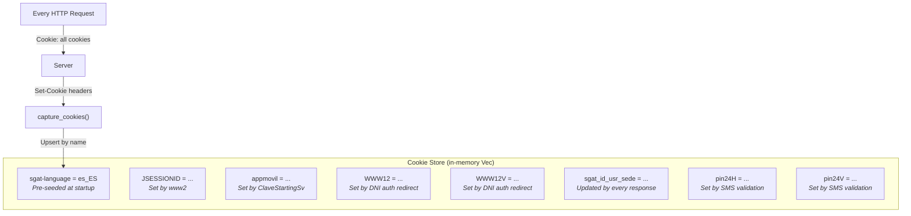
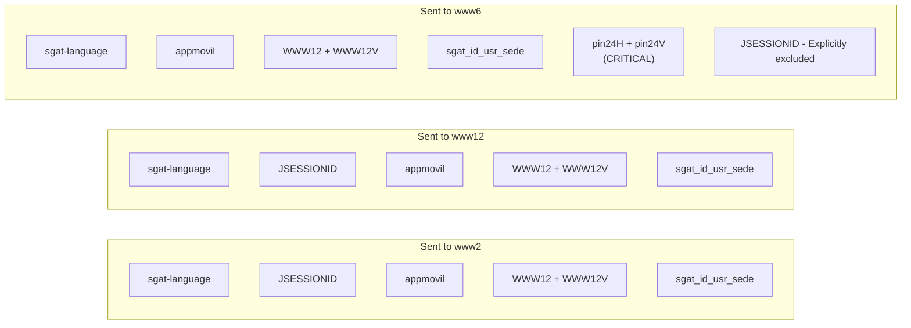

# Cookie Management

The client manages cookies **manually** across all three AEAT subdomains. This is necessary because:

1. The Android app uses `CookiePolicy.ACCEPT_ALL` which forwards all cookies to all subdomains regardless of domain-matching rules.
2. Standard HTTP clients (like reqwest) follow RFC domain-matching rules, which would prevent cookies set by `www2` from being sent to `www6` or `www12`.
3. The server relies on cookies being forwarded cross-domain (e.g., `WWW12` set during DNI auth on www2 must reach www6 for activation).

## Cookie Store Design

## Key Cookies

| Cookie | Set By | Purpose | Required For |
|--------|--------|---------|--------------|
| `sgat-language` | Pre-seeded at client startup | Language preference (`es_ES`) | All requests |
| `appmovil` | `ClaveStartingSv` response | Base64-encoded JSON identifying the app version, OS, and device model | All subsequent requests |
| `JSESSIONID` | www2 during DNI auth | WebSphere session affinity for www2 cluster | www2 requests only. **Must be stripped for www6.** |
| `WWW12` | DNI auth redirect chain | Authentication token for www12 | www12 and www6 endpoints |
| `WWW12V` | DNI auth redirect chain | Timestamp companion to `WWW12` | www12 and www6 endpoints |
| `sgat_id_usr_sede` | Updated by most responses | JSON-encoded session state (access type, timestamp, user name) | All requests (informational) |
| `pin24H` | `ValidarClaveMovilSMS` response | Proof of SMS verification. Long encrypted token. | **Device activation on www6** |
| `pin24V` | `ValidarClaveMovilSMS` response | Timestamp companion to `pin24H` | Device activation on www6 |

## Cookie Propagation Rules

## JSESSIONID Stripping

The `JSESSIONID` from www2's WebSphere cluster **must be explicitly removed** before calling www6's `ClaveActivateAuthenticationSv`. Each subdomain runs a separate WebSphere cluster, and sending a foreign `JSESSIONID` causes the server to return HTML instead of JSON.

See [AEAT Infrastructure](../architecture/aeat-infrastructure.md) for background on the WebSphere cluster isolation.

## Cookie Lifecycle

This diagram shows which cookies exist at each point in the [DNI/NIE + SMS activation flow](../authentication-flows/dni-nie-sms-activation.md):

```mermaid
gantt
    title Cookie Lifecycle During Authentication
    dateFormat X
    axisFormat %s

    section sgat-language
    Pre-seeded at startup       :active, 0, 6

    section appmovil
    Set by ClaveStartingSv      :active, 1, 6

    section JSESSIONID
    Set by DNI auth             :active, 2, 5
    Stripped for www6            :crit, 5, 6

    section WWW12 + WWW12V
    Set during DNI redirect     :active, 2, 6

    section sgat_id_usr_sede
    Set during DNI redirect     :active, 2, 6

    section pin24H + pin24V
    Set by SMS validation       :active, 4, 6

    section Step Markers
    0 ClaveStartingSv           :milestone, 0, 0
    1 AutenticaDniNie           :milestone, 1, 1
    2 ClaveRequestState         :milestone, 2, 2
    3 ObtenerSMS                :milestone, 3, 3
    4 ValidarSMS                :milestone, 4, 4
    5 ActivateAuth              :milestone, 5, 5
```

## Cookie Serialization Between Phases

Because Phase 1 and Phase 2 of the [activation flow](../authentication-flows/dni-nie-sms-activation.md) may be separated by user interaction time (entering the SMS code), the cookies must be serialised to JSON after Phase 1 and deserialised before Phase 2. This ensures the session state is preserved even if the HTTP client is destroyed and recreated between phases.

The Android app stores serialised cookies in `EncryptedSharedPreferences` under the key `map_cookies` as a JSON HashMap.

## Implementation Notes

- The client **must not** use the HTTP client's built-in cookie store. Standard cookie stores follow RFC domain-matching rules, which prevent `www2` cookies from being sent to `www6` or `www12`.
- Cookies are managed via `JavaNetCookieJar` through `CookiesManagerSingleton` in the original app. Before each API call, the Repository calls `setCookiesInJar()` to ensure proper cookie state.
