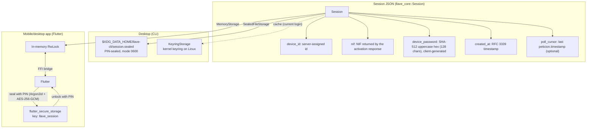

# Session Persistence

After device activation succeeds, the session is persisted for later operations: revealing PINs, polling for and confirming requests, history, and deactivation.

## Session Data



| Field | Notes |
|-------|-------|
| `device_id` | From `ClaveActivateAuthenticationSv`. Activation fails if it is missing or empty |
| `nif` | The server's `respuesta.nif`, like the app's `saveNifUsuario`. Falls back to the typed NIF only if the response has none |
| `device_password` | Generated locally before activation ([Device Password](../cryptography/device-password.md)). Zeroized in memory and redacted in `Debug` |
| *(none)* | Older versions also stored `firebase_token` (always `null`); llave registers no push token and ignores the field when loading |
| `created_at` | Set at activation |
| `poll_cursor` | `ClaveRequestAllOperationsSv` cursor (see [Polling](../authentication-flows/pending-operations-polling.md#timestamp-cursor)). `#[serde(default)]`, so sessions saved without it still load |

## Session Lifecycle

1. **Creation**: after `ClaveActivateAuthenticationSv` returns (`auth::session_from_activation`; see [DNI/NIE + SMS Activation](../authentication-flows/dni-nie-sms-activation.md)).
2. **Storage**: serialised as JSON and saved through the registered `SecureStorage` backend.
3. **Use**: loaded for each operation ([PIN](../authentication-flows/pin-request.md), [polling](../authentication-flows/pending-operations-polling.md), [confirm/reject](../authentication-flows/clave-movil.md), [QR](../authentication-flows/qr-code.md)).
4. **Cursor updates**: each `peticion.timestamp` seen in AllOperations or `ClaveMovilQrSv` responses is written back into the stored session (`record_cursor`). A failure to persist it is logged and is not fatal.
5. **Deletion**:
   - explicit `logout`;
   - `deactivate`, only once the server confirms. On any other `KO` the credentials are kept so the user can retry;
   - automatically on error `105`/`109` (device revoked), as the app does. Error `416` does **not** delete the session.

   In Flutter the core reports these as error kind `device_revoked`; `AuthNotifier.reportFailure` then deletes the sealed blob too. A failed `deactivate` keeps it and shows the error.

   `Session::delete()` also resets the in-memory poll cursor and the shared HTTP client.

## FFI Bridge Pattern

For the Flutter app, the session crosses the Rust/Dart boundary, and Flutter only ever stores the session **sealed with the user's PIN**:

```
Startup:
  1. init_core(null)                         -> Rust MemoryStorage, empty
  2. SecureSessionStore.read()               -> sealed blob exists? -> "locked" state

Unlock (user enters PIN):
  3. decrypt_and_load_session(sealed, pin)   -> open_session + set_session_data

After activation (user picks a PIN):
  4. encrypt_session(pin)                    -> seal_session(get_session_data())
  5. SecureSessionStore.write(sealed)        -> flutter_secure_storage "llave_session"
                                                (Linux fallback: ~/.local/share/llave/session.enc)
```

> In Flutter, changes made in Rust after sealing, such as `poll_cursor`
> updates, live only in `MemoryStorage` until the session is sealed again.

## CLI flow

The CLI seals the session with a PIN like the app, because the keyring crate's
`linux-native` backend is the kernel keyring: memory-only, cleared on reboot
(and WSL kernels lack persistent keyrings).

```
activate:  before any request, storage::prepare_new_session -> PinRequest::Create
           (entered twice, 3 tries), so a typo cannot lose server-side credentials
           first save -> seal_session -> session.sealed (0600) + kernel keyring cache
command:   kernel keyring cache hit   -> no PIN
           cache empty (after reboot) -> PinRequest::Unlock (3 attempts)
           -> open_session -> refill cache
updates:   PIN known in this process  -> reseal the file
           otherwise (e.g. poll_cursor) -> cache only; credentials stay sealed
logout / deactivate: delete file + cache
```

`llave activate` refuses to run while `session.sealed` exists, so credentials
are only ever written together with a new PIN.

## Storage Backends

| Backend | Platform | Mechanism |
|---------|----------|-----------|
| `SealedFileStorage` | CLI | PIN-sealed file `$XDG_DATA_HOME/llave-cli/session.sealed` (Argon2id + AES-256-GCM, 0600, atomic write), with `KeyringStorage` as cache |
| `KeyringStorage` | CLI cache | `keyring` crate (`linux-native`: kernel keyring), service `llave-cli`, account `session`. Not durable on its own |
| `MemoryStorage` | FFI / Flutter | In-memory `RwLock<Option<Zeroizing<String>>>`. Flutter persists the PIN-sealed blob |

The CLI also writes a non-secret `config.json` under the XDG config directory (`llave-cli/`), holding `nif`, `device_id` and an optional `proxy`.

See [Credential Storage](../cryptography/credential-storage.md) for the sealing format, and [System Overview](../architecture/system-overview.md) for the full architecture.
