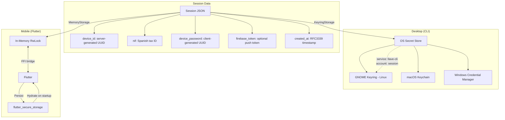

# Session Persistence

After successful device activation, the session is persisted for future use (requesting PINs, checking pending authentications, etc.).

## Session Data



## Session Lifecycle

1. **Creation**: After `ClaveActivateAuthenticationSv` returns `device_id` (see [DNI/NIE + SMS Activation](../authentication-flows/dni-nie-sms-activation.md)).
2. **Storage**: Serialised as JSON and saved to platform-specific secure storage.
3. **Usage**: Loaded for subsequent operations ([PIN requests](../authentication-flows/pin-request.md), [auth confirmation](../authentication-flows/clave-movil.md)).
4. **Deletion**: On explicit deactivation or logout.

## FFI Bridge Pattern

For mobile (Flutter) apps, the session crosses the Rust/Dart boundary:

```
Flutter startup:
  1. flutter_secure_storage.read("session") -> JSON
  2. FFI call: set_session_data(json) -> Rust MemoryStorage

After activation:
  1. Rust saves to MemoryStorage
  2. FFI call: export_session() -> JSON
  3. Flutter: flutter_secure_storage.write("session", json)
```

## Storage Backends

| Backend | Platform | Mechanism |
|---------|----------|-----------|
| `KeyringStorage` | Desktop (Linux, macOS, Windows) | OS secret store via `keyring` crate. Service name: `llave-cli`, account: `session`. |
| `MemoryStorage` | Mobile (Flutter) | In-memory `RwLock<Option<Session>>`. Hydrated from Flutter's `flutter_secure_storage` on startup via FFI. |

See [System Overview](../architecture/system-overview.md) for the full architecture diagram.
